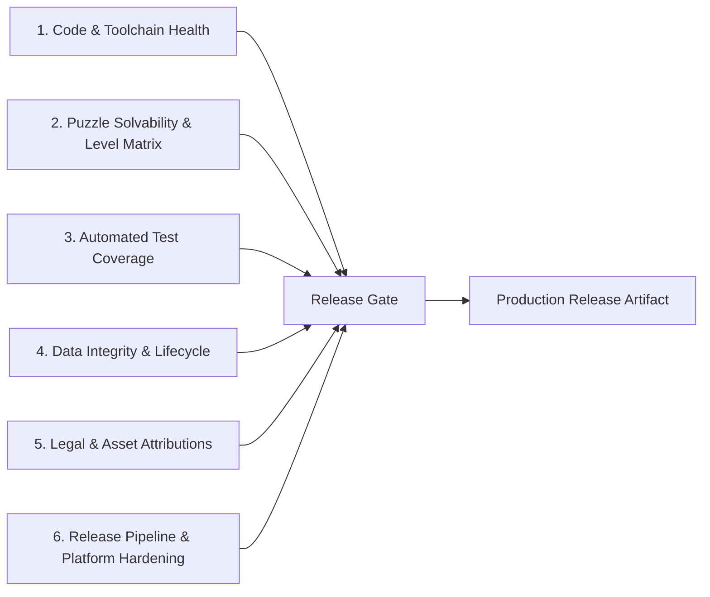

# 🚀 Reference: Launch Readiness Verification & Audit Specification

This document serves as the formal technical reference specification for evaluating and verifying release readiness across **Parable Bloom** applications, services, and tooling.

> **Last audit:** 2026-10-14 — `parable-bloom` app `1.9.12+32`, scope **Android + Web**. Verdict: **Conditional GO** (ship after Firebase Hosting ensure lands + one preview-channel and one Play internal-track prove-out). iOS/macOS out of scope (ExportOptions placeholders, `if: false` CI jobs).
> **Quick wins delivered 2026-10-15:** silent-catch logging, `og:image`/`twitter:image`, hosting security headers, `usesCleartextTraffic="false"`, value-object `==`/`hashCode`, partial-run warning, root CHANGELOG placeholder cleanup.

---

## 🎯 Verification Framework Overview

Release candidates must satisfy verification criteria across six core technical pillars prior to store submission or production deployment:

---

## 📋 Release Verification Gates

### 1. Code & Toolchain Health

- [x] **Monorepo Validation**: `task validate` executes cleanly across all projects (Flutter app, Next.js site, Go level-builder) with zero failures.
- [x] **Static Analysis**: `task flutter:analyze` returns **zero warnings and zero errors** (verified 2026-10-14, `apps/parable-bloom`). Note: `analysis_options.yaml` includes only bare `flutter_lints` with zero custom rules active, so a clean pass is a weak signal.
- [x] **Go Toolchain Alignment**: Inherits Go `1.27.1` workspace-wide; `task lb:lint`, `task lb:test`, and `task lb:build` pass cleanly.
- [x] **Dependencies Hygiene**: Production dependencies contain zero test-only packages; `mocktail` and `test` isolated to `dev_dependencies`. `vector_math` pinned to `^2.4.3` (`apps/parable-bloom/pubspec.yaml:48`) — `any` removed 2026-10-14 for reproducible builds.
- [ ] **Release shrinking (P1)**: `android/app/build.gradle.kts:45-56` declares `proguardFiles` but never sets `isMinifyEnabled` / `isShrinkResources` — releases ship unobfuscated/unshrunk. Enable and prove on internal track before prod.
- [x] **Value-object hygiene (delivered 2026-10-15)**: `VineState`, `CameraState`, `VineData`, `MaskData`, `LevelData` now implement `==`/`hashCode`.

### 2. Puzzle Solvability & Level Matrix

- [x] **Level Solvability**: Go `level-builder` validator is canonical — Dart `test/level_validation_test.dart:8-22` is structural smoke only and never calls `solve()`/`isSolvable()` (`:292-298`). Gate on `task levels:validate` + `task levels:tutorials:validate` (CI `ci.yml:117-120`), not Flutter tests alone. Corpus audited: **504 `assets/levels/level_*.json`** + 5 lessons (doc previously said 105 — stale 5×21 claim).
- [x] **Lesson System**: All 5 progressive lessons (`lesson_1.json` to `lesson_5.json`) load and validate against structural rules.
- [x] **Occupancy & Connectivity**: 100% playable coverage (vine cells + masked cells) with valid head-to-tail path continuity; Go validator gates solvable + coverage + quality.
- [ ] **Known solver caveats (P1/P2, latent)**: solver ignores `mask` by design (mask is visuals-only per level spec); `>24`-vine heuristic (`level_solver_service.dart:203-357`) can false-negative — corpus max ~12 vines so not blocking. `grid_size` `[rows, cols]` ↔ Dart `width/height` mapping (`level_data.dart:197-198`) is self-consistent; confirm against Go orientation before any refactor.

### 3. Automated Test Suite

- [x] **Unit & Integration Suite**: All Flutter unit and repository tests pass (verified 2026-10-14: 521 passed across `level_validation` + `hive_repository` + `vine_animation`; ~50 test files / ~266 cases repo-wide, zero `skip:`/`flaky` markers).
- [x] **Screen Widget Tests**: Widget tests in place for primary views:
  - `HomeScreen` (`test/features/home/presentation/screens/home_screen_test.dart`)
  - `SettingsScreen` (`test/features/settings/presentation/screens/settings_screen_test.dart`)
  - `JournalScreen` (`test/features/journal/presentation/screens/journal_screen_test.dart`)
  - `GameHeader` & `PauseMenuDialog` (`test/features/game/presentation/widgets/game_header_and_pause_dialog_test.dart`)
- [x] **Partial-run guard (delivered 2026-10-15)**: `level_validation_test.dart` prints a `WARNING` when `PB_LEVEL_START/END` partial filters are set; release gate runs the full matrix unset.

### 4. Data Integrity & App Lifecycle

- [x] **Hive source of truth**: `hive_repository_test.dart` + `firebase_repository_test.dart` enforce all reads/writes through the Hive `Box`; Firestore is sync-only (no-auto-push when local-ahead/divergent, `keepCloud/keepLocal`, timeout-no-throw).
- [x] **Account Deletion Flow**: In-app account deletion resets local storage and deletes Firestore cloud documents prior to Firebase Auth user deletion.
- [x] **Engine Teardown**: Flame `GardenGame` instance initialized in `initState()` and explicitly disposed in `dispose()`.
- [x] **Crash Fallback & Router Boundaries**: `GoRouter` configured with `errorBuilder` and `ErrorWidget.builder` registered for graceful error recovery.
- [ ] **Init ordering (P1)**: `main.dart:45-89` initializes Hive after Firebase/auth (network-adjacent delay on offline-first load); progress `initialize()` fires post-frame (`parable_bloom_app.dart:47-49`) so first frame renders defaults. Add timeout + skeleton/await before prod polish.
- [x] **Silent catch (delivered 2026-10-15)**: `progress_providers.dart` `syncFromCloud` failure now logs via `LoggerService.warn`.
- [ ] **Firestore hardening (P2)**: per-user `uid == userId` scoping is correct and `configs_prod` auth-gating works via anonymous guest session (`main.dart:124-140`); dev/preview `configs_*` public-read is intentional. No `request.resource` size/schema checks — compromised client can write large docs (quota/cost).

### 5. Legal & Asset Attributions

- [x] **Licensing Attribution**: All audio assets, fonts (Fraunces, Playfair Display, Alegreya Sans), textures, and devotionals fully documented in `documentation/reference/attributions.md`.
- [x] **Scripture Compliance**: Scripture quotations comply with copyright and gratis usage guidelines documented in `documentation/reference/scripture-licensing.md`.
- [x] **Branding & Social Metadata**: Web PWA `manifest.json` configured with brand green `#177245` and `#1A2E3F` background; Open Graph and Twitter text tags populated (`web/index.html:29-38`).
- [x] **Link previews (delivered 2026-10-15)**: `og:image` / `twitter:image` point at `https://parable-bloom.web.app/icons/Icon-512.png`.

---

### 6. Release Pipeline & Platform Hardening

- [x] **Firebase Hosting site ensure (P0 fix, delivered 2026-10-14)**: Firebase stopped auto-creating the default Hosting site on first deploy (enforced Oct 15 2026). `task firebase:hosting:ensure` (`hosting:sites:get || hosting:sites:create parable-bloom --project parable-bloom`) is now a `deps` of `hosting:deploy`, `h:deploy`, and `hosting:channel:deploy` (`.taskfiles/Firebase.yml`); explicit ensure steps added to `.github/workflows/deploy-web.yml` and `publish.yml`; troubleshooting in `documentation/how-to/release-process.md`.
- [x] **Android signing**: release `signingConfig` + `taskGraph.whenReady` fail-fast on missing `ANDROID_*` env/keystore (`build.gradle.kts:36-43,62-86`) — no debug-key fallback. AD_ID stripped (`AndroidManifest.xml:12-13`); permissions minimal (`INTERNET`, `ACCESS_NETWORK_STATE`).
- [x] **Telemetry privacy**: Sentry DSN via `--dart-define` (no hardcoded secret), `sendDefaultPii` unset (false), `tracesSampleRate 0.2` (`error_reporting_service.dart`). Crashlytics breadcrumb dual-sink noted — keep opt-outs in sync.
- [x] **Web security headers (delivered 2026-10-15)**: `firebase.json` hosting sets `nosniff`, `SAMEORIGIN`, HSTS. CSP intentionally deferred (needs `flutter_bootstrap.js` tuning).
- [x] **Android hardening (delivered 2026-10-15)**: explicit `usesCleartextTraffic="false"` + `allowBackup="true"`. No `network_security_config.xml` (defaults safe).
- [x] **Release hygiene (delivered 2026-10-15)**: root `CHANGELOG.md` `1.1.x–1.3.x` `TODO` placeholders collapsed to an archived note; `apps/parable-bloom/CHANGELOG.md` (via `nx release`) is the source of truth — regenerate before tagging.

---

## 🛠️ Automated Verification Commands

| Step                   | Command                           | Expected Result                             |
| :--------------------- | :-------------------------------- | :------------------------------------------ |
| **Monorepo Health**    | `task validate`                   | Exit code 0, all Nx targets green           |
| **Level Solvability**  | `task levels:validate`            | Exit code 0, full 504-level corpus solvable |
| **Level Tutorials**    | `task levels:tutorials:validate`  | Exit code 0, 5/5 lessons valid              |
| **Static Analysis**    | `task flutter:analyze`            | Exit code 0, "No issues found!"             |
| **Flutter Test Suite** | `task flutter:test`               | Exit code 0, all unit/widget tests passing  |
| **Hosting Ensure**     | `task firebase:hosting:ensure`    | Exit code 0, site exists (idempotent)       |
| **Go Level Builder**   | `task lb:test`                    | Exit code 0, all Go package tests passing   |
| **Next.js Web Site**   | `nx run parable-bloom-site:build` | Exit code 0, static generation complete     |
